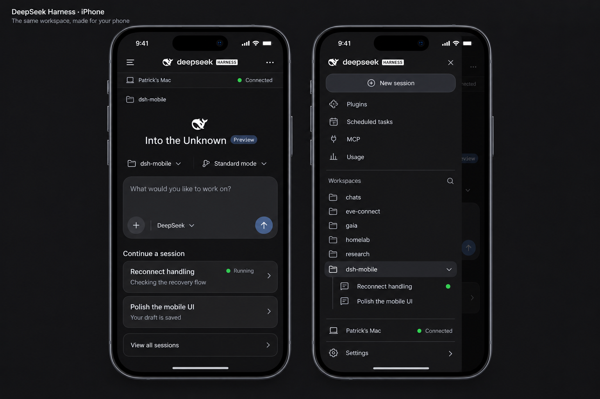
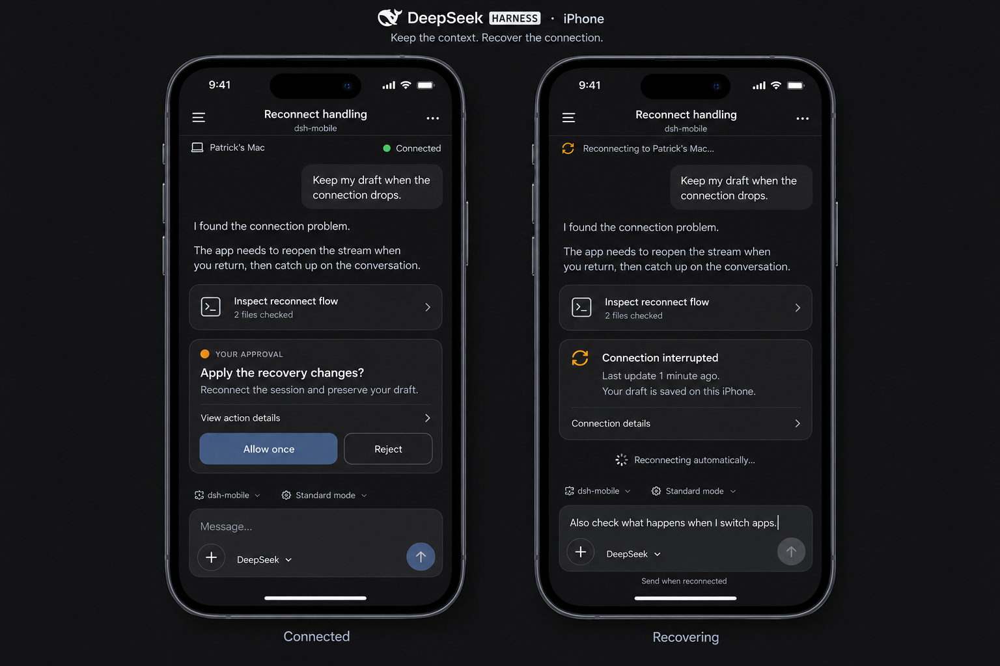

# dsh-mobile

An iPhone client for a [DeepSeek Harness](https://github.com/hazyumps) relay: pair with the
harness running on your computer, then read and drive your sessions from the phone.

Native SwiftUI, iOS 18+, no third-party dependencies. The transport, state and persistence live
in a Swift package (`DSHRemoteKit`) that is testable on its own; the app target is the UI.

<p align="center">
  
  
</p>

## What works

- **Pairing** with a relay by code or pasted payload, TLS pinned to the host's key, credential
  in the Keychain.
- **Home**: workspaces and sessions from the host's registry, recent cards with real titles and
  live state ("Running", "Needs your input"), a composer that creates a session on first send.
- **Conversation**: bounded live stream, markdown (headings, lists, tables, quotes, code),
  tool and activity rows, older-history paging, inline images and file attachments read back
  from the host, slash commands from the host's own catalogue.
- **Approvals and questions**: cards fed by the host's `$events` waterfalls, answered through
  `$events/result`; the timed-question claim is owned by the conversation screen.
- **Secondary screens**: session-scoped usage, plugin inventory, scheduled tasks (capability
  gated — see *Known gaps*), Settings with a previewable diagnostics export.

## Known gaps

These are real, and they are the reason the issue list is long rather than empty:

- **Not at parity with the desktop app.** The desktop reads a usage ledger (balance, by-model,
  by-day) and a scheduled-tasks service that the relay does not expose to remote clients —
  `schedule/catalog` and `schedule/list` return 404 over the relay, and no usage endpoint exists
  in the descriptor at all. Phone-side screens cannot fix that; the relay has to expose it.
- **Approvals and the timed claim are covered by unit tests only.** No host we have access to
  raises an approval or a timed wait, so those paths have never run against a real one.
- **Physical-device checks outstanding**: the photo and file pickers, background recovery, and
  the timed claim under a lock.

## Building

Requires Xcode 16 or newer (iOS 18 SDK) and [XcodeGen](https://github.com/yonaskolb/XcodeGen).

```sh
# The app project is generated; it is not checked in.
cd Apps/DSHRemote
xcodegen generate
open DSHRemote.xcodeproj
```

`Apps/DSHRemote/project.yml` sets a `DEVELOPMENT_TEAM`, which is the maintainer's. **Set it to
your own team** (or pick one in Xcode's Signing pane) before building for a device — a simulator
build needs no identity.

Tests run without Xcode:

```sh
swift test --disable-sandbox     # 450 tests across 31 suites
```

`--disable-sandbox` is needed because SwiftPM's manifest cache lives outside the working tree.

## Layout

| Path | What it is |
| --- | --- |
| `Sources/DSHRemoteKit/` | Transport, state stores, persistence, presentation logic. All the testable parts. |
| `Sources/DSHRemoteKit/Generated/` | Protocol models generated from `Protocol/` by `Tools/generate-models.py`. Do not edit by hand. |
| `Apps/DSHRemote/` | The SwiftUI app: screens, design system, debug affordances. |
| `Protocol/` | The relay's endpoint descriptor, schemas and examples, extracted by `Protocol/extract.py`. |
| `Tests/DSHRemoteKitTests/` | The test suite, including fixtures captured from a live host. |
| `design/` | The implementation spec and the UX mockups this app was built against. |
| `Tools/` | Probes, capture scripts and the model generator. |

## Debug affordances

A simulator cannot tap, so interactive paths are reachable by environment variable in debug
builds — `DSH_PAIRING_PAYLOAD`, `DSH_OPEN_HOST`, `DSH_OPEN_SESSION`, `DSH_SESSION_ID`,
`DSH_SEND_MESSAGE`, `DSH_NEW_SESSION_MESSAGE`, `DSH_MODE`, `DSH_MODEL`, `DSH_DESTINATION`,
`DSH_ATTACH`, `DSH_IMAGE`, `DSH_ANSWER`, `DSH_DRAFT`, `DSH_SETTINGS`, `DSH_DIAGNOSTICS`,
`DSH_SCREEN_GALLERY`, `DSH_DESIGN_GALLERY`, `DSH_TRACE`. `Apps/DSHRemote/README.md` describes
each one; `DSH_TRACE=1` with `xcrun simctl launch --console-pty` prints a decisions trace.

## Contributing

Issues are the front door: features, host gaps and papercuts all belong there. If you are
changing the transport or a store, run `swift test` and expect a fixture to be the right place
for protocol shapes — several of them were captured from a live host and the comments say so.

## Licence

MIT — see [LICENSE](LICENSE). The app icon is derived from DeepSeek's logo and is included for
personal builds; fork it with your own mark if you ship it anywhere public.
